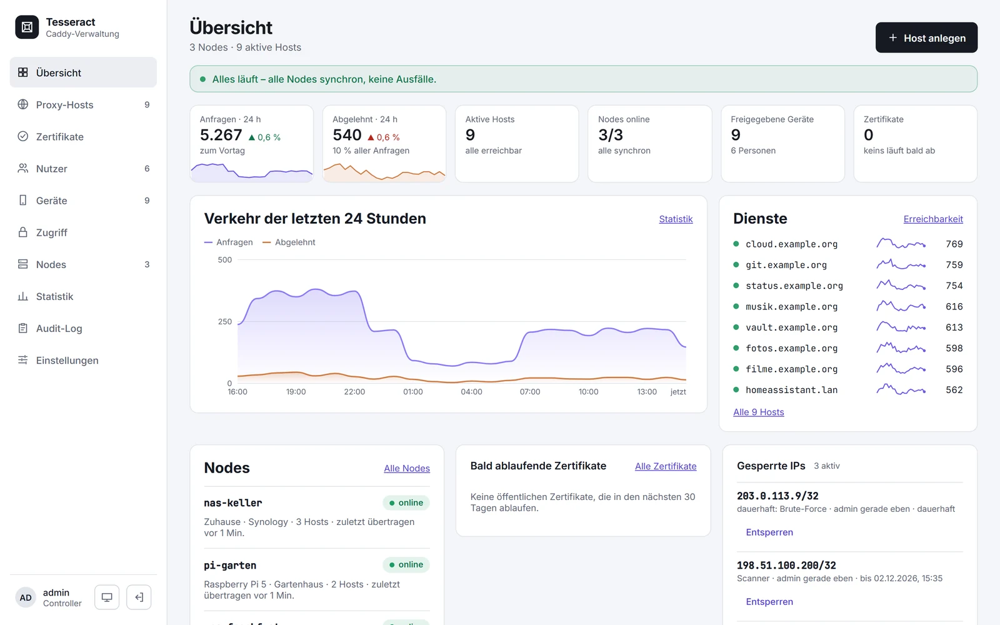
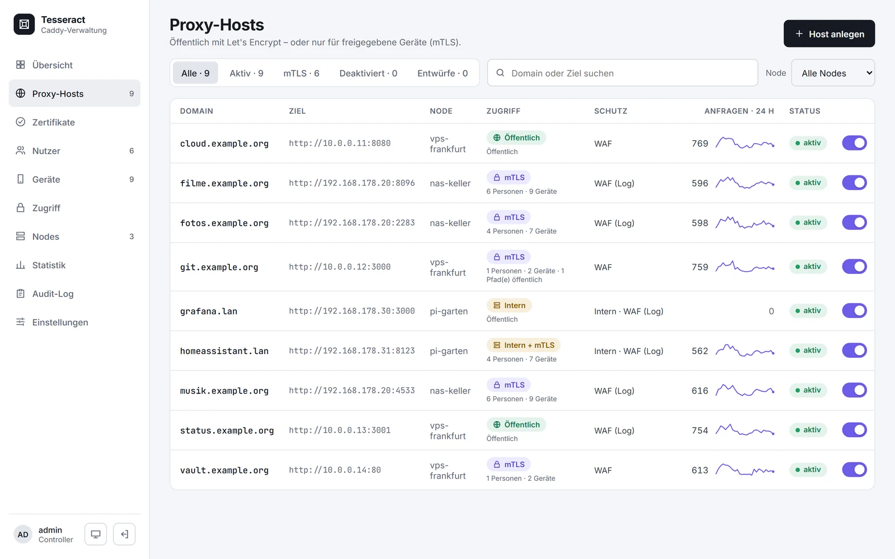
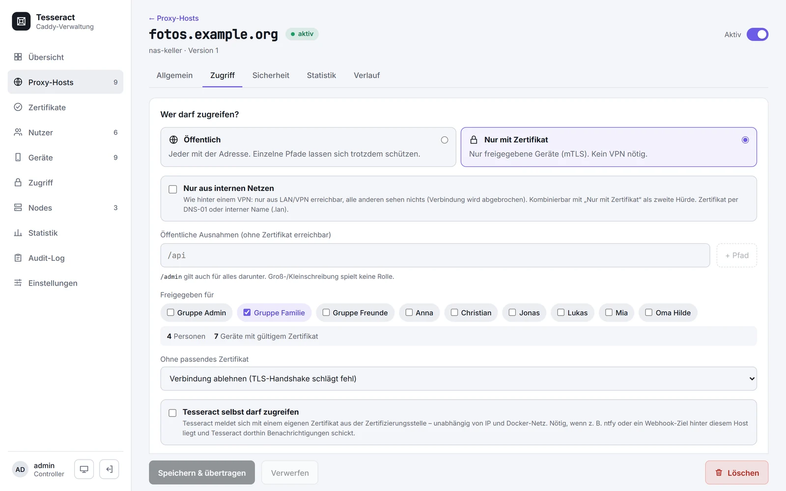
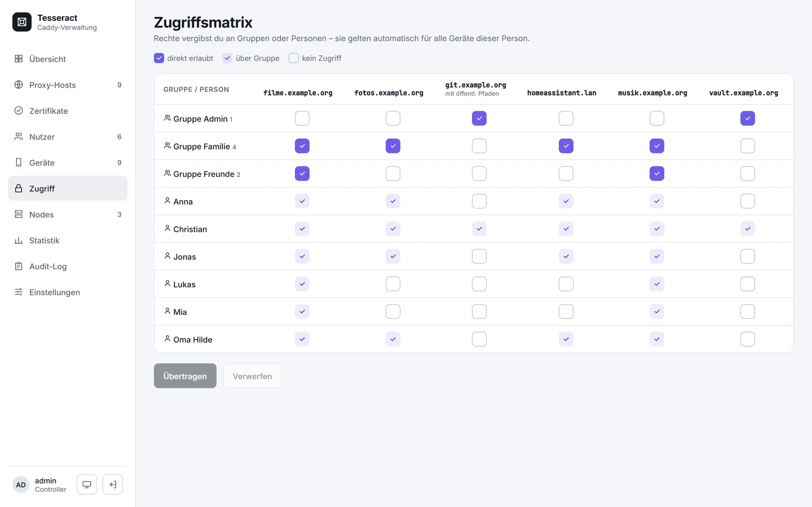
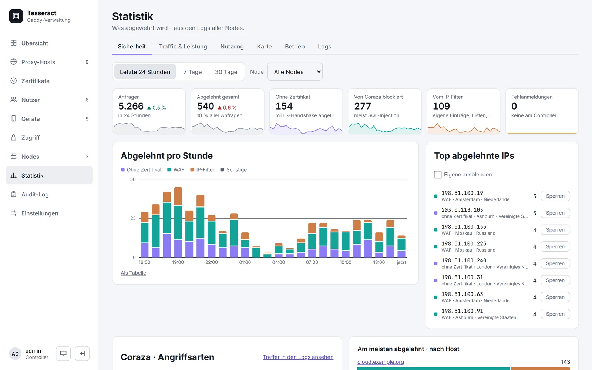
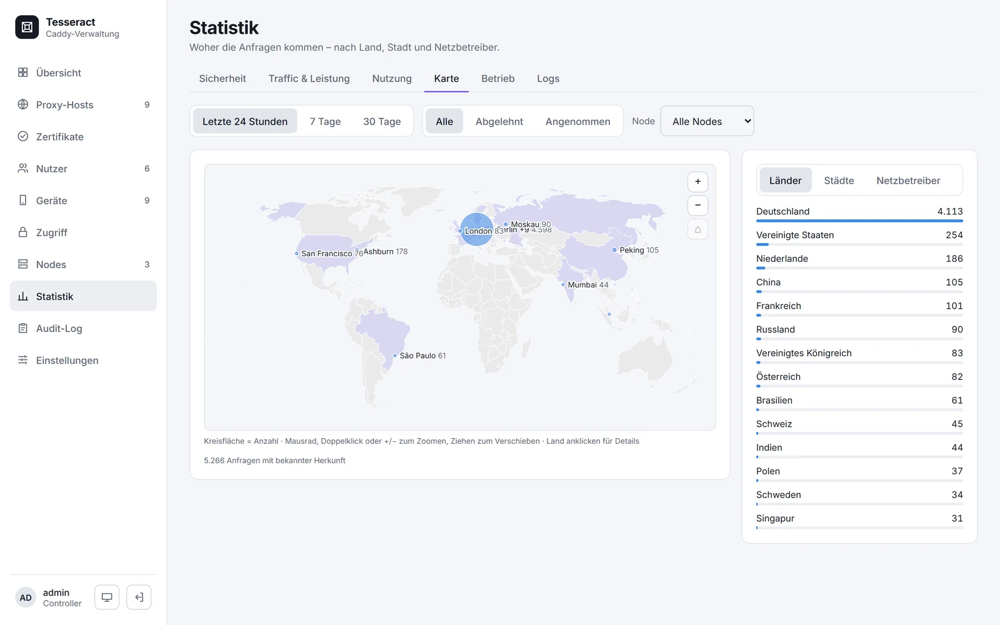
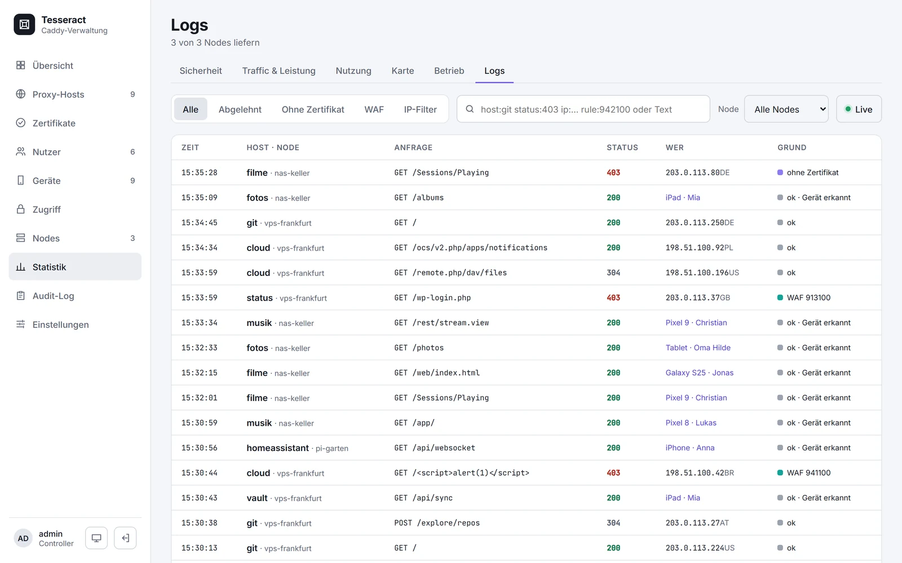
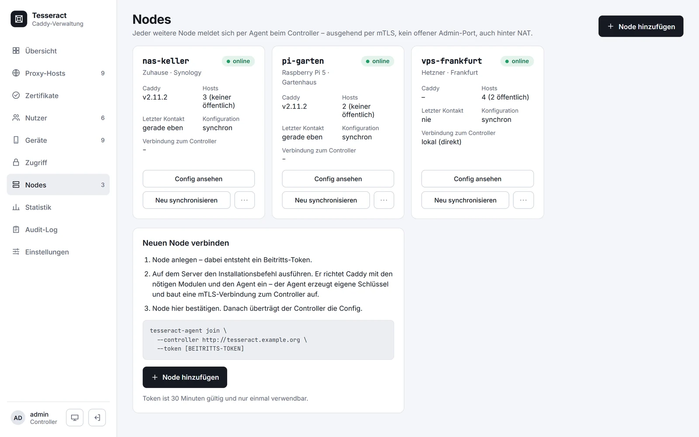
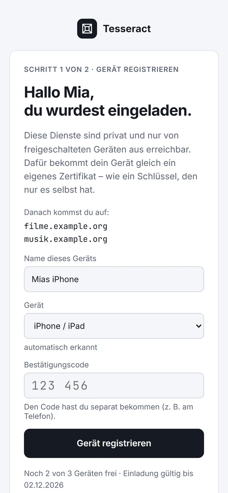

# Tesseract

**One web interface for all your Caddy nodes** – an alternative to Nginx Proxy Manager (NPM),
with **mTLS instead of a VPN** and a built-in **Coraza WAF**.

<picture>
  <source media="(prefers-color-scheme: dark)" srcset="docs/images/overview-dark.webp">
  
</picture>

- **Public hosts** get Let's Encrypt certificates automatically – just like NPM (HTTP-01, or
  DNS-01 via Cloudflare, including wildcards).
- **Private services** are reachable only from approved devices: every device gets its own
  client certificate from Tesseract's own CA. Without a valid certificate not even the TLS
  handshake succeeds – no VPN client, no exposed login page.
- **Coraza WAF** with the OWASP Core Rule Set, IP filters, country filters and automatic bans
  per host.
- **Multiple nodes** (VPS, NAS, Raspberry Pi …) are managed centrally. Each node connects to
  the controller through an agent – even behind NAT, without an open admin port.
- **Invitations by link**: guests register their device themselves and install the
  certificate with a step-by-step guide for their platform.
- **Observability**: central logs from all nodes, statistics (security, traffic, usage, origin
  map), tamper-evident audit log, Prometheus metrics, notifications via e-mail, webhook and
  ntfy. Logs can also be stored in Loki or VictoriaLogs.
- **Operations**: encrypted backups (local, S3, Restic), CA rotation, SSO (OIDC), passkeys,
  LDAP sync, Docker labels, automatic Cloudflare DNS records.

> The user interface and the detailed documentation in [`docs/`](docs/README.md) are in German.
> Changes: [CHANGELOG.md](CHANGELOG.md) · Roadmap: [docs/roadmap.md](docs/roadmap.md)

## Screenshots

<table>
<tr><td width="50%" valign="top">

<picture>
  <source media="(prefers-color-scheme: dark)" srcset="docs/images/hosts-dark.webp">
  
</picture>

**Proxy hosts** – All hosts at a glance – public, mTLS-only or internal, with WAF status and requests.

</td><td width="50%" valign="top">

<picture>
  <source media="(prefers-color-scheme: dark)" srcset="docs/images/host-access-dark.webp">
  
</picture>

**Access per host** – Who may access a host: public, certificate only, internal networks, public exceptions per path.

</td></tr>
<tr><td width="50%" valign="top">

<picture>
  <source media="(prefers-color-scheme: dark)" srcset="docs/images/access-matrix-dark.webp">
  
</picture>

**Access matrix** – Grant access to groups or persons – it applies to all of their devices.

</td><td width="50%" valign="top">

<picture>
  <source media="(prefers-color-scheme: dark)" srcset="docs/images/stats-security-dark.webp">
  
</picture>

**Security statistics** – What gets blocked: missing certificate, Coraza WAF, IP filter – per hour and by IP.

</td></tr>
<tr><td width="50%" valign="top">

<picture>
  <source media="(prefers-color-scheme: dark)" srcset="docs/images/stats-map-dark.webp">
  
</picture>

**Origin map** – Where requests come from – by country, city and network operator.

</td><td width="50%" valign="top">

<picture>
  <source media="(prefers-color-scheme: dark)" srcset="docs/images/logs-dark.webp">
  
</picture>

**Central logs** – Live logs from all nodes with filter syntax, the reason for every rejection and the device behind a request.

</td></tr>
<tr><td width="50%" valign="top">

<picture>
  <source media="(prefers-color-scheme: dark)" srcset="docs/images/nodes-dark.webp">
  
</picture>

**Nodes** – Further Caddy servers connect through an agent – outbound via mTLS, even behind NAT.

</td></tr>
</table>

<table><tr><td width="260" valign="top">

<picture>
  <source media="(prefers-color-scheme: dark)" srcset="docs/images/invite-mobile-dark.webp">
  
</picture>

</td><td valign="top">

**Invitations by link** – guests open the link on their phone, enter the confirmation code and install their personal certificate with a guide for their platform. No app, no VPN client.

The screenshots show a demo instance with made-up people and domains; the interface follows the light or dark system theme.

</td></tr></table>

## Quick start

Requirements: a Linux server (amd64 or arm64) with Docker Compose ≥ 2.24, ports 80 and 443,
and a DNS name for the web interface.

```bash
mkdir tesseract && cd tesseract
curl -LO https://raw.githubusercontent.com/HiCubeBot/tesseract/main/compose.yaml
curl -L https://raw.githubusercontent.com/HiCubeBot/tesseract/main/.env.example -o .env
```

Edit `.env` – at least:

```ini
TESSERACT_DOMAIN=tesseract.example.com
TESSERACT_ADMIN_PASSWORD=a-long-password      # at least 12 characters
TESSERACT_ACME_EMAIL=admin@example.com
TESSERACT_VERSION=1.18.0                       # pin a version instead of "latest"
```

Start it (images come from the GitHub Container Registry):

```bash
docker compose pull
docker compose up -d
```

The web interface is then available at `https://<TESSERACT_DOMAIN>` – only via that name, not
via the server's IP address. If `TESSERACT_ADMIN_PASSWORD` is empty, a random password is
printed on first start:

```bash
docker compose logs tesseract | grep "Erster Start"
```

Prefer building yourself? Clone the repository and run `docker compose up -d --build`.

Further nodes are added from the web interface (*Nodes › Neuen Node verbinden*) with a one-line
installer and a join token. Details: [docs/installation.md](docs/installation.md),
[docs/agent.md](docs/agent.md), [docs/operations.md](docs/operations.md).

## Project layout

```
tesseract/
├─ frontend/          Svelte 5 + Vite (TypeScript) – web UI
├─ backend/           Python 3.13, FastAPI, managed with uv – controller
│  ├─ src/tesseract/  application code
│  └─ tests/          pytest
├─ agent/             agent for further nodes (Python, uv)
├─ docker/caddy/      Caddy image with Coraza and DNS modules
├─ docker/node/       Compose template for further nodes
├─ docs/              all documentation (German)
├─ Dockerfile         controller image (builds frontend + backend)
└─ compose.yaml       controller + Caddy
```

## Development

Backend (port 8000):

```bash
cd backend
uv sync
cp .env.example .env
uv run tesseract
```

Frontend (port 5173, proxies `/api` to the backend):

```bash
cd frontend
npm install
npm run dev
```

Tests and linting:

```bash
(cd backend && uv run pytest && uv run ruff check . && uv run ruff format --check .)
(cd agent && uv run pytest && uv run ruff check . && uv run ruff format --check .)
(cd frontend && npm run check && npm run build)
```

## Documentation

| Document | Content |
|---|---|
| [Features](docs/features.md) | complete feature list |
| [Roadmap](docs/roadmap.md) | phases and milestones |
| [Architecture](docs/architecture.md) | components, data flow, security model |
| [Installation](docs/installation.md) | setup step by step |
| [Operations](docs/operations.md) | updates, backups, troubleshooting |
| [Security](docs/security.md) | security review and hardening |
| [Backend](docs/backend.md) · [Frontend](docs/frontend.md) · [Agent](docs/agent.md) | components |
| [Deployment](docs/deployment.md) | Docker, Compose, Caddy image |
| [Contributing](docs/contributing.md) | Git workflow, branches, pull requests |
